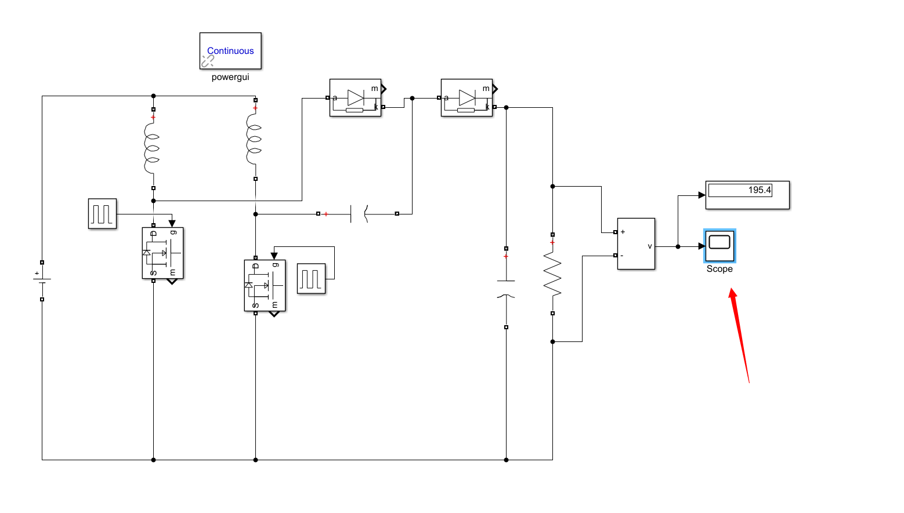

# DC-DC boost converter simulation with 2 inductors, 2 capacitors, and 2 MOSFET switches using Simulink

DC-DC boost converter, including 2 inductors, 2 capacitors, and 2 MOSFET switches Simulink simulation

## Images

<!-- PAYMENT_BLOCK -->

## Get this dataset

- Payment link (Stripe): [Buy now](https://buy.stripe.com/3cs8yP7sY87d0vu9AB)
- Payment QR code: 

<!-- /PAYMENT_BLOCK -->
